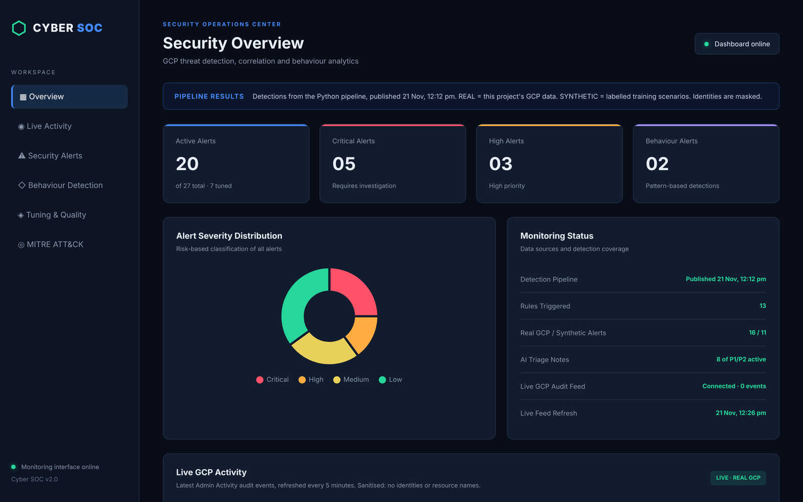
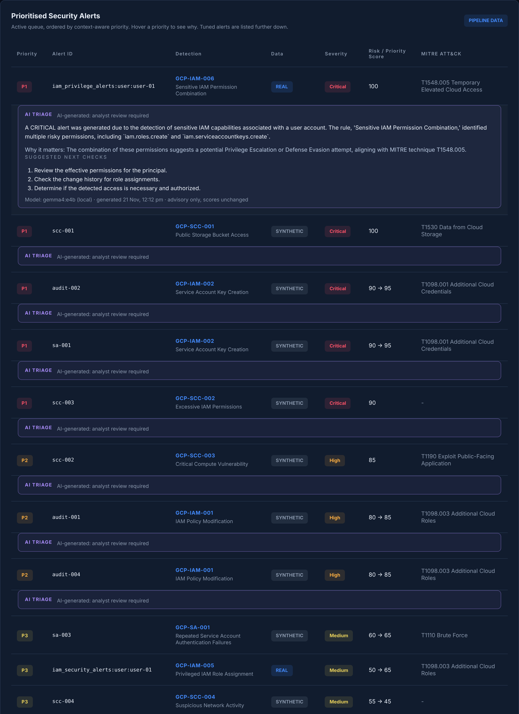
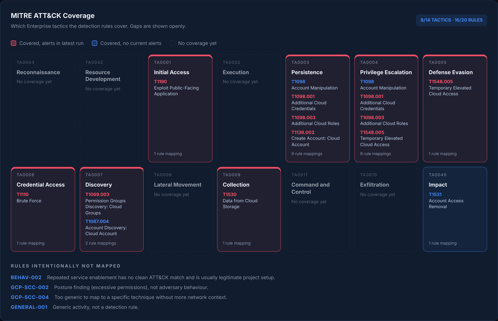
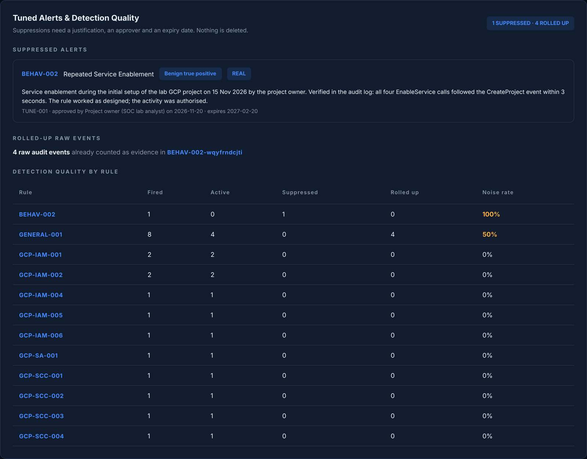
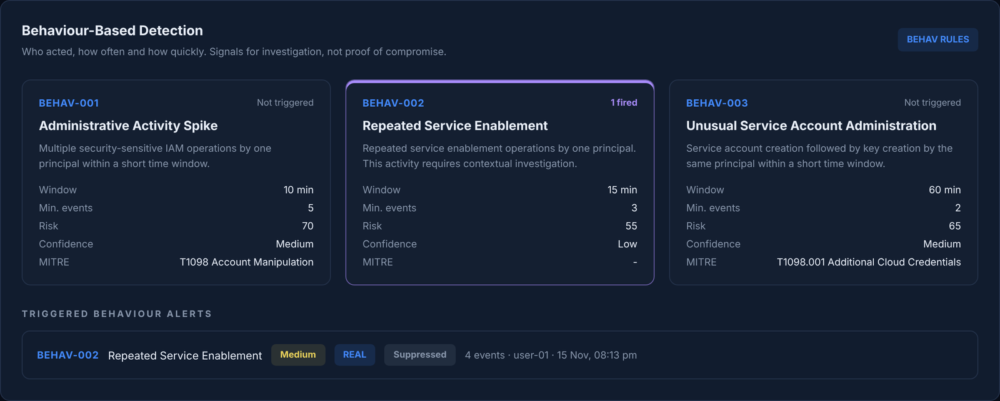
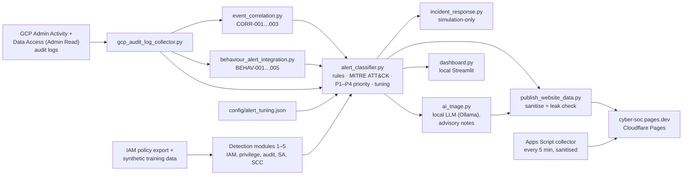

# GCP Cloud Threat Detection & Incident Response

A free, end-to-end Google Cloud threat detection and SOC project built in Python. It collects real GCP Admin Activity audit logs, runs rule-based, correlation and behaviour detections, enriches every alert with MITRE ATT&CK, prioritises alerts with explainable context scoring, tunes out authorised activity with expiring suppressions, simulates incident response, and publishes sanitised results to a public SOC dashboard.

**Live dashboard:** https://cyber-soc.pages.dev/



## At a glance

- **19 detection rules:** 11 rule-based GCP detections, 3 multi-event correlations, 5 behaviour rules (including 2 Discovery rules on real Data Access logs), plus generic triage of all other audit events.
- **MITRE ATT&CK:** 16 of 20 rules mapped to 11 techniques across 8 of 14 Enterprise tactics. Unmapped rules and uncovered tactics are listed openly.
- **Prioritisation:** P1–P4 priority with a per-alert explanation of every score adjustment.
- **Tuning:** analyst dispositions, expiring suppressions with justification, roll-up of duplicate evidence, and a per-rule noise report.
- **Incident response:** lifecycle with persistence, analyst approval, simulation-only actions.
- **AI-assisted triage:** a local LLM (Ollama) writes clearly labelled, advisory triage notes for active P1/P2 alerts from sanitised, identity-free input, with prompt-injection defences and an output leak check.
- **Real vs simulated:** every alert is labelled REAL, SIMULATED, SYNTHETIC or MIXED from its own evidence.
- **Privacy:** the public site never shows emails, project IDs, resource names or raw logs; a leak check blocks publication otherwise.
- **Tested:** a unit test suite plus an end-to-end test that runs a simulated attack through every pipeline stage.
- **Free:** runs on free tiers with GCP billing disabled.

## Screenshots

| Prioritised alert queue with AI triage | MITRE ATT&CK coverage |
|---|---|
|  |  |

| Alert tuning and detection quality | Behaviour-based detection |
|---|---|
|  |  |

All screenshots show real pipeline output from the public site: identities are masked and real GCP data is labelled separately from synthetic training scenarios.

## Architecture



## Quick start

```bash
python3 -m pip install -r requirements.txt

python detection/gcp_audit_log_collector.py      # collect real audit events (needs gcloud auth)
python3 detection/event_correlation.py           # CORR rules
python3 detection/behaviour_alert_integration.py # BEHAV rules
python3 detection/alert_classifier.py            # rules, MITRE, priority, tuning
python3 detection/incident_response.py           # simulation-only incidents
python3 detection/ai_triage.py                   # local AI triage notes (needs Ollama)
python3 detection/publish_website_data.py        # sanitised website data

python -m pytest -q                              # full test suite, incl. end-to-end
python3 -m http.server 8000 --directory website  # preview the public site
```

## Project phases

| Phase | Scope |
|---|---|
| 1 | Detection modules for IAM, privilege escalation, audit logs, service accounts and SCC; unified SOC classifier; incident response; Streamlit dashboard |
| 2 | Named GCP detection rules with MITRE ATT&CK, event-ID-aware deduplication, multi-event correlation |
| 3 | Incident lifecycle with validated transitions, persistence across runs, analyst approval, simulation-only response actions |
| 4 | Behaviour detection, MITRE enrichment and coverage matrix, risk prioritisation, alert tuning and detection quality, website integration, end-to-end testing |
| 5 | AI-assisted triage with a local LLM: advisory, sanitised, injection-resistant, validated |
| 5.1 | Discovery detection on real Data Access logs (BEHAV-004, BEHAV-005), MITRE coverage 7 → 8 tactics |

## Design principles

- **Free:** no GCP billing, no paid resources.
- **Honest labelling:** real GCP data and simulated scenarios are always distinguished.
- **Investigation signals, not verdicts:** alerts and MITRE mappings show what a rule is designed to surface; they do not prove compromise.
- **Simulation-only response:** nothing in the pipeline modifies GCP resources.
- **Explainable decisions:** priority scores list their factors; suppressions carry a justification, an approver and an expiry date.
- **Sanitised public data:** a leak check refuses to publish emails, project identifiers or resource names.

## Technology Stack

- Google Cloud Platform: IAM, Cloud Audit Logs, Cloud Logging Python client
- Google Apps Script (live sanitised feed, time-driven trigger)
- Python 3.12, pytest / unittest
- Streamlit, Plotly, Pandas (local dashboard)
- HTML, CSS, JavaScript, Chart.js (public dashboard)
- Cloudflare Pages (deploys `website/` from the `main` branch)
- Git and GitHub

---

## Module 1: GCP IAM Misconfiguration Detection

Analyses exported GCP IAM policies to identify potentially risky permissions and access configurations.

### Detection capabilities

- Owner role assignments.
- Editor role assignments.
- Public principal exposure.
- Broadly accessible principals.
- Privileged service-account role assignments.

### Security reporting

Generates structured JSON alerts containing:

- Timestamp
- Principal
- IAM role
- Risk score
- Severity
- Detection findings
- Event source

### Run detector

```bash
python3 detection/iam_misconfiguration.py
```

---

## Module 2: IAM Privilege Escalation Detection

Analyses IAM policy bindings against a role-permission catalogue to identify sensitive IAM capabilities.

### Detection capabilities

- Detects sensitive service-account permissions.
- Identifies permissions that can modify project IAM policies.
- Flags role creation and role-update capabilities.
- Calculates risk scores.
- Generates JSON alert reports.

### Test coverage

- Owner role with sensitive permissions.
- Service Account Token Creator role.
- Normal Viewer role.
- Unknown roles.
- Severity classification.

**Note:** `sample_data/role_definitions.json` contains synthetic test data and is not a verified export of Google's predefined IAM roles.

---

## Module 3: GCP Cloud Audit Logs Monitoring

This module analyses Cloud Audit Log events to identify potentially suspicious administrative activities.

### Detection capabilities

- IAM policy modification detection.
- Service-account key creation detection.
- Failed administrative operation detection.
- Risk scoring and severity classification.
- JSON alert report generation.

### Run detection

```bash
python3 detection/audit_log_monitor.py
```

### Live GCP integration

An additional collector retrieves real GCP Admin Activity audit events using the Google Cloud Logging Python client.

**Collector capabilities:**

- Authenticates using Google Application Default Credentials.
- Retrieves Admin Activity audit events from the configured GCP project.
- Collects events from the previous 24 hours.
- Retrieves up to 100 events per execution.
- Extracts event IDs, timestamps, methods, services, principals and resources.
- Saves the collected events to a local JSON report.

### Configure authentication

Install and configure the Google Cloud CLI, then authenticate:

```bash
gcloud auth login
```

Configure Application Default Credentials:

```bash
gcloud auth application-default login --disable-quota-project
```

Install the logging dependency:

```bash
python3 -m pip install google-cloud-logging
```

### Run live GCP collector

```bash
python detection/gcp_audit_log_collector.py
```

Output:

```text
reports/gcp_audit_logs.json
```

The collector retrieves a snapshot when executed. It does not currently provide continuous streaming or scheduled ingestion.

**Important:** Real audit events are not automatically evidence of malicious activity. They require contextual investigation.

---

## Module 4: Suspicious Service Account Activity Detection

Analyses service-account activity events to identify potentially suspicious behaviour.

### Detection capabilities

- Service-account key creation detection.
- Authentication outside configured normal hours.
- Multiple failed authentication attempts.
- Failed authentication detection.
- Risk scoring and severity classification.
- JSON alert report generation.

### Run detection

```bash
python3 detection/service_account_monitor.py
```

**Note:** The existing service-account training events are synthetic data.

---

## Module 5: Security Command Center Findings Analysis

Analyses Security Command Center findings and prioritises cloud security risks.

### Detection capabilities

- Public cloud storage exposure detection.
- Critical vulnerability prioritisation.
- Over-privileged IAM finding analysis.
- Suspicious network activity categorisation.
- Inactive finding filtering.
- Risk scoring and priority classification.
- JSON alert report generation.

### Run analyzer

```bash
python3 detection/scc_findings_analyzer.py
```

**Note:** Existing SCC findings are synthetic training data, not live Security Command Center findings.

---

## Module 6: Unified SOC Alert Classification Engine

Consolidates security alerts from Modules 1–5 and the GCP Cloud Audit Logs collector into a central SOC alert feed.

### Capabilities

- Normalises different security alert formats.
- Integrates collected GCP audit events.
- Applies consistent risk-based severity classification.
- Supports CRITICAL, HIGH, MEDIUM and LOW priorities.
- Deduplicates alerts within the same source module.
- Sorts alerts by risk score.
- Generates consolidated severity summaries.
- Exports a unified JSON alert report.

### Severity classification

| Risk score | Severity |
|---|---|
| 90–100 | CRITICAL |
| 70–89 | HIGH |
| 30–69 | MEDIUM |
| 0–29 | LOW |

### Initial GCP event triage rules

| GCP audit event | Initial risk score |
|---|---:|
| Service-account key creation | 90 |
| IAM policy modification | 80 |
| Service-account key deletion | 70 |
| Service-account creation | 40 |
| Service enablement | 20 |
| Project creation | 20 |
| Operation status retrieval | 5 |
| Other events | 10 |

These are initial heuristic triage scores, not proof of malicious activity. Contextual detection and analyst investigation are required.

### Run classifier

```bash
python detection/alert_classifier.py
```

Output:

```text
reports/consolidated_soc_alerts.json
```

---

## Module 7: Incident Response Automation

Generates incident response plans from consolidated SOC alerts.

### Capabilities

- Reviews consolidated security alerts.
- Generates incidents for CRITICAL and HIGH severity alerts.
- Assigns unique incident references.
- Extracts affected principals and resources.
- Recommends response actions based on alert characteristics.
- Assigns response priorities.
- Maintains analyst approval status.
- Saves incident records in JSON format.

### Safety controls

- Simulation-only execution.
- No automatic changes to GCP resources.
- Analyst approval required before response.
- Local incident audit report.

### Run incident response engine

```bash
python3 detection/incident_response.py
```

### Run Module 7 tests

```bash
python3 -m unittest tests.test_incident_response -v
```

---

## Module 8: SOC Security Dashboard and Reporting

An interactive SOC dashboard built using Streamlit, Plotly and Pandas.

### Dashboard features

- Total security alerts and incident KPIs.
- Alert severity distribution.
- Alerts by detection module.
- Risk score distribution.
- Prioritised SOC alert table.
- Incident response tracking.
- CSV exports for alerts and incidents.
- Live GCP Cloud Audit Events section in the local environment.
- Masking of displayed email addresses.
- Local security report and public demo data separation.
- Behaviour-Based Detections section: rule catalogue, triggered behaviour alerts, real/simulated data labels and the contributing audit events for each alert.

### Run the dashboard

Install project dependencies:

```bash
python3 -m pip install -r requirements.txt
```

Launch:

```bash
python3 -m streamlit run dashboard.py
```

Open:

```text
http://localhost:8501
```

### Data source behaviour

**Local environment**

When both local consolidated alert and incident reports are available, the dashboard loads local security reports and displays the GCP audit events from the local collector report when available.

**Public deployment**

The public Streamlit deployment uses sanitized fictional demo data. It does not have access to local GCP credentials or local audit reports.

---

## Phase 2: GCP Threat Detection Engine

Phase 2 moves beyond single-event alerts with named detection rules and multi-event correlation.

### Rule-based detections

The SOC classifier maps alerts to named detection rules with a risk score, confidence level, analyst recommendation and, where applicable, a MITRE ATT&CK technique.

| Rule | Detection | Risk | MITRE ATT&CK |
|---|---|---:|---|
| GCP-IAM-001 | IAM policy modification | 80 | T1098.003 |
| GCP-IAM-002 | Service-account key creation | 90 | T1098.001 |
| GCP-IAM-003 | Service-account key deletion | 70 | T1531 |
| GCP-IAM-004 | Service-account creation | 40 | T1136.003 |
| GCP-IAM-005 | Privileged IAM role assignment | 50 | T1098.003 |
| GCP-IAM-006 | Sensitive IAM permission combination | 100 | T1548.005 |
| GCP-SA-001 | Repeated service-account authentication failures | 60 | T1110 |
| GCP-SCC-001 | Public storage bucket access | 100 | T1530 |
| GCP-SCC-002 | Excessive IAM permissions | 90 | - |
| GCP-SCC-003 | Critical compute vulnerability | 85 | T1190 |
| GCP-SCC-004 | Suspicious network activity | 55 | - |

### Event correlation

`detection/event_correlation.py` links related audit events by the same principal:

| Rule | Correlation | Risk | MITRE ATT&CK |
|---|---|---:|---|
| CORR-001 | Service-account creation followed by key creation (60 min) | 85 | T1098.001 |
| CORR-002 | Service-account key creation followed by IAM policy modification (60 min) | 95 | T1098.003 |
| CORR-003 | Repeated sensitive administrative activity (3+ in 15 min) | 75 | T1098 |

```bash
python3 detection/event_correlation.py
```

Output: `reports/gcp_event_correlations.json`

---

## Phase 4: Behaviour-Based Anomaly Detection

Phase 4 looks at who acted, how often and how quickly.

### Behaviour rules

`detection/behaviour_anomaly_detector.py` detects activity patterns per principal using time windows and thresholds:

| Rule | Behaviour | Window | Min. events | Risk | Confidence | MITRE ATT&CK |
|---|---|---:|---:|---:|---|---|
| BEHAV-001 | Administrative activity spike (sensitive IAM operations) | 10 min | 5 | 70 | MEDIUM | T1098 Account Manipulation |
| BEHAV-002 | Repeated service enablement | 15 min | 3 | 55 | LOW | - |
| BEHAV-003 | Service-account creation followed by key creation | 60 min | 2 | 65 | MEDIUM | T1098.001 Additional Cloud Credentials |
| BEHAV-004 | Cloud account enumeration: programmatic service-account and key discovery calls using ≥ 3 different methods | 10 min | 6 | 50 | LOW | T1087.004 Account Discovery: Cloud Account |
| BEHAV-005 | IAM permission discovery: programmatic policy, permission and role queries using ≥ 2 different methods | 10 min | 6 | 50 | LOW | T1069.003 Permission Groups Discovery: Cloud Groups |

Design choices:

- BEHAV-004 and BEHAV-005 run on **Data Access (Admin Read)** audit logs, collected into a separate file so routine reads never become individual alerts. They require **breadth** (several different discovery methods) as well as volume, so repeatedly reading one policy or listing one resource type does not fire, while systematic enumeration does.

- Only explicitly selected sensitive IAM methods count towards BEHAV-001, so normal project setup (CreateProject, EnableService, GetOperation) does not trigger it.
- Events with missing or invalid timestamps are ignored, and duplicate event IDs are not double-counted.
- Every alert is labelled `REAL`, `SIMULATED` or `MIXED` according to the source of its evidence, so test data is never mistaken for live activity.
- All contributing events are preserved as evidence for the analyst.

`detection/behaviour_alert_integration.py` runs all three rules against the collected audit events and writes a behaviour report. The SOC classifier then merges these alerts into the consolidated feed, where they are deduplicated and prioritised alongside every other alert.

```bash
python3 detection/behaviour_alert_integration.py
```

Output: `reports/gcp_behaviour_alerts.json`

### Live result

Run against the project's real GCP Admin Activity events, BEHAV-002 fired once: four service enablements within two seconds during initial project setup. It was classified as MEDIUM severity with LOW confidence and labelled `REAL`. This is expected legitimate activity, and the rule's LOW confidence reflects that service enablement often has a valid business reason.

### MITRE ATT&CK enrichment and coverage

`detection/mitre_mapping.py` is the single source of truth for ATT&CK mappings. Every SOC alert (rule-based, correlation and behaviour) carries `mitre_technique_id`, `mitre_technique_name` and `mitre_tactics`.

Coverage: **8 of 14 Enterprise tactics**, **16 of 20 rules** mapped, **11 unique techniques**.

| Tactic | Techniques | Rules |
|---|---|---|
| TA0043 Reconnaissance | No coverage | - |
| TA0042 Resource Development | No coverage | - |
| TA0001 Initial Access | T1190 Exploit Public-Facing Application | GCP-SCC-003 |
| TA0002 Execution | No coverage | - |
| TA0003 Persistence | T1098 Account Manipulation<br>T1098.001 Additional Cloud Credentials<br>T1098.003 Additional Cloud Roles<br>T1136.003 Create Account: Cloud Account | BEHAV-001, CORR-003, BEHAV-003, CORR-001, GCP-IAM-002, CORR-002, GCP-IAM-001, GCP-IAM-005, GCP-IAM-004 |
| TA0004 Privilege Escalation | T1098 Account Manipulation<br>T1098.001 Additional Cloud Credentials<br>T1098.003 Additional Cloud Roles<br>T1548.005 Temporary Elevated Cloud Access | BEHAV-001, CORR-003, BEHAV-003, CORR-001, GCP-IAM-002, CORR-002, GCP-IAM-001, GCP-IAM-005, GCP-IAM-006 |
| TA0005 Defense Evasion | T1548.005 Temporary Elevated Cloud Access | GCP-IAM-006 |
| TA0006 Credential Access | T1110 Brute Force | GCP-SA-001 |
| TA0007 Discovery | T1069.003 Permission Groups Discovery: Cloud Groups<br>T1087.004 Account Discovery: Cloud Account | BEHAV-005, BEHAV-004 |
| TA0008 Lateral Movement | No coverage | - |
| TA0009 Collection | T1530 Data from Cloud Storage | GCP-SCC-001 |
| TA0011 Command and Control | No coverage | - |
| TA0010 Exfiltration | No coverage | - |
| TA0040 Impact | T1531 Account Access Removal | GCP-IAM-003 |

Rules intentionally not mapped:

- `BEHAV-002`: Repeated service enablement has no clean ATT&CK match and is usually legitimate project setup.
- `GCP-SCC-002`: Posture finding (excessive permissions), not adversary behaviour.
- `GCP-SCC-004`: Too generic to map to a specific technique without more network context.
- `GENERAL-001`: Generic activity, not a detection rule.

Leaving these unmapped is deliberate: forcing a technique onto a posture finding or generic activity would overstate coverage. The uncovered tactics are listed openly as candidates for future detections.

Print the current matrix:

```bash
python3 detection/mitre_mapping.py
```

A mapped alert is not confirmation that the technique was used; it shows which adversary behaviour the rule is designed to surface.

### Risk scoring and prioritisation

`detection/risk_prioritisation.py` adds context to the rule-based score. Each alert keeps its `risk_score` and `severity` (the rule's verdict, also used by incident response) and gains:

- `priority_score`: the risk score adjusted for context, capped to 0–100
- `priority`: P1 (≥ 90), P2 (70–89), P3 (40–69), P4 (< 40)
- `score_factors`: every adjustment applied and why

| Factor | Adjustment |
|---|---:|
| Confidence | HIGH +5, MEDIUM 0, LOW −10 |
| Privileged principal (same identity has a GCP-IAM-005 or GCP-IAM-006 finding) | +10 |
| Multiple signals (two or more different rules fired for the same identity) | +10 |
| High-impact MITRE tactic (Privilege Escalation, Credential Access, Impact) | +5 |

GENERAL-001 events do not count as a signal and receive no context boosts. Synthetic and simulated alerts are not down-weighted; the `REAL` / `SYNTHETIC` label already separates them.

Example from the live data: the real BEHAV-002 alert has risk score 55. Its priority score is 65 (P3): −10 for LOW confidence, +10 because the same principal holds a privileged role, and +10 because several rules fired for that principal. The consolidated report adds a `priority_summary`, and the website shows each alert's priority with the explanation on hover.

### False-positive analysis and alert tuning

`detection/alert_tuning.py` applies analyst-approved tuning rules from `config/alert_tuning.json` and rolls up duplicate evidence. Every alert gets:

- `status`: `OPEN` (active queue), `SUPPRESSED` (matched an approved tuning rule) or `ROLLED_UP` (raw event already counted as evidence in a behaviour or correlation alert)
- `disposition`: `UNREVIEWED`, `BENIGN_TRUE_POSITIVE` (rule correct, activity authorised) or `FALSE_POSITIVE` (rule logic wrong)

Tuning controls:

- Every tuning rule must have a justification, an approver and an **expiry date**. Expired rules stop matching automatically, and rules expiring within 14 days are flagged.
- Principals are matched by the SHA-256 hash of the normalised identity, so the committed tuning file contains no email address. (An unsalted hash prevents casual exposure; it cannot stop someone confirming an address they already suspect.)
- Suppressed and rolled-up alerts are never deleted. They are excluded from incident response and from the active priority counts, and listed with their justification.
- Invalid tuning rules (missing expiry, unknown disposition, an email in the approver field, or a plain email instead of a hash) are rejected.

Example from the live data:

| Alert | Outcome | Reason |
|---|---|---|
| BEHAV-002 (repeated service enablement) | `SUPPRESSED`, `BENIGN_TRUE_POSITIVE` | TUNE-001: initial project setup by the owner. All four EnableService calls followed CreateProject within 3 seconds. Expires 2027-02-20. |
| 4 × GENERAL-001 EnableService events | `ROLLED_UP` | Already evidence in the BEHAV-002 alert |

Result: 21 alerts, 16 active, 1 suppressed, 4 rolled up. The consolidated report adds `active_alert_count`, `status_summary` and a `detection_quality` report: per rule, how many alerts fired, how many stayed active, were suppressed or were rolled up, and the noise rate. The website shows the same in its "Tuned Alerts & Detection Quality" section.

### Discovery detection on real Data Access logs

Admin Activity logs only record changes. Reconnaissance (listing accounts, reading IAM policies) appears only in **Data Access** audit logs, which are off by default. This project enables only the **Admin Read** log type for the **IAM** and **Cloud Resource Manager** APIs, which keeps log volume tiny and within Cloud Logging's free ingestion allotment. It was verified to work on the project with billing disabled.

The collector writes these events to `reports/gcp_data_access_logs.json` (private) with a coarse `client_type` (gcloud, console, client library); the raw user agent is not stored. The project ID is read from `GCP_PROJECT_ID` or the active gcloud configuration, never from code.

### Real-data validation of the Discovery rules

The discovery rules were tested against real activity in the lab project on 21 Nov 2026, not only against simulated scenarios:

| Test | What was logged (Admin Read) | Result |
|---|---|---|
| `gcloud` enumeration: `get-iam-policy`, `list-grantable-roles`, `roles describe` × 2 | GetIamPolicy × 2, QueryGrantableRoles × 4. `roles describe` (GetRole) **not logged** | 6 calls, 2 methods |
| Same, plus `testIamPermissions` via the REST API | testIamPermissions **not logged** | 12 calls, 2 methods |
| Console browsing of the IAM, Service Accounts and Roles pages (~7 min) | 197 events, mostly GetResourceBillingInfo and GetProject, plus QueryGrantableRoles × ~25, ListRoles × 4, ListServiceAccounts × 2 (all `client_type` = console) | BEHAV-005 **fired: false positive**, fixed (see below) |

Findings and tuning decisions:

- Via `gcloud` and the REST API, `GetIamPolicy`, `QueryGrantableRoles` and `ListServiceAccounts` were logged, while `GetRole` (predefined role) and `testIamPermissions` left no trace. Attacker tooling that relies on `testIamPermissions` is therefore invisible to log-based detection here. This is a documented **telemetry gap**, not a rule bug. (The console's own `ListRoles` calls were logged.)
- BEHAV-005 originally required three different methods, so it could never fire on real data. It was tuned to **≥ 2 methods and ≥ 6 calls in 10 minutes**, which detects the real test above while repeated single-method reads still do not fire.
- **False positive found and fixed:** ordinary console browsing generates many `QueryGrantableRoles` and `ListRoles` calls in the background, and BEHAV-005 fired on it. Thresholds could not separate the two cases (browsing produced *more* calls than the real enumeration test), but the client type could. BEHAV-004 and BEHAV-005 now count only **programmatic** access (gcloud, API, SDK) and ignore console-originated reads. A regression test replays the real console session. Known gap: someone enumerating manually in the console is not detected by these rules.
- BEHAV-004 keeps **≥ 3 methods** and is validated on simulated scenarios only, because the lab project has no service accounts to enumerate.
- A regression test replays the exact real-world method pattern, so future changes cannot silently break the tuned rule.

### Public website publication

The public Cyber SOC website (https://cyber-soc.pages.dev/) shows the pipeline's results. `detection/publish_website_data.py` converts the consolidated report into `website/data/soc_alerts.json`:

- Real email addresses become aliases (`user-01`, `service-account-01`).
- Resource names are replaced by their type (for example "Storage bucket"); project IDs and numbers are removed.
- Every alert is labelled `REAL` or `SYNTHETIC`.
- A final leak check refuses to write the file if any email address, project identifier or resource name remains.

```bash
python3 detection/publish_website_data.py
```

The website is deployed with Cloudflare Pages from the `website/` folder of the `main` branch. A separate Google Apps Script collector provides a sanitised live feed of Admin Activity events (timestamp, method, service, severity and status only).

### Full pipeline order

```bash
python detection/gcp_audit_log_collector.py
python3 detection/event_correlation.py
python3 detection/behaviour_alert_integration.py
python3 detection/alert_classifier.py      # also applies config/alert_tuning.json
python3 detection/incident_response.py     # skips suppressed and rolled-up alerts
python3 detection/ai_triage.py             # optional: local AI triage notes
python3 detection/publish_website_data.py
python3 -m streamlit run dashboard.py
```

### Run all tests

```bash
python3 -m pytest -q tests
```

---

## Phase 5: AI-Assisted Triage

`detection/ai_triage.py` uses a local model through [Ollama](https://ollama.com/) to write a short triage note for every active P1/P2 alert: a summary, why it matters, and up to three suggested next checks. The model runs on the analyst's machine, so it is free and no alert data leaves it.

Safeguards:

- **Advisory only.** Notes never change risk score, severity, priority, status or incidents, and every note is labelled "AI-generated: analyst review required" with the model name and time.
- **Minimal, identity-free input.** The model receives the rule, severity, MITRE technique, score factors, evidence methods, services and risky permissions, plus the principal's *type* (for example "user account" or "Storage bucket"). It never receives emails, project IDs or resource names; the input passes through the same sanitiser and leak check as the website.
- **Prompt-injection resistance.** Alert content is untrusted data, placed between `<alert_data>` tags with an instruction never to follow text inside it. Output is constrained to a JSON schema and validated again in Python.
- **Output leak check.** Notes containing an email address, project identifier, resource path, long numeric ID or URL are rejected, not published.
- **Freshness.** Notes are cached by an input hash. The publisher shows a note only while the alert is still an active P1/P2 and its input is unchanged.
- **Graceful failure.** If Ollama is not running, the step reports it and the rest of the pipeline is unaffected.

Setup and run:

```bash
ollama pull gemma4:e4b                 # or any local model with JSON output
python3 detection/ai_triage.py         # writes reports/ai_triage.json (private)
python3 detection/publish_website_data.py
```

Configuration: `AI_TRIAGE_MODEL` (default `gemma4:e4b`) and `OLLAMA_URL` (default `http://localhost:11434`). The tests use a fake model and need no network.

---

## Project Validation

`tests/test_end_to_end_pipeline.py` runs a simulated attack (service-account creation, key creation and IAM policy changes) plus authorised project setup through every stage in a temporary folder: correlation, behaviour detection, classification, MITRE enrichment, prioritisation, tuning, incident response and website publication. It checks every hand-off, including that simulated events are never published as REAL.

The full automated test suite (`python -m pytest -v`) covers the detection modules, rule classification, deduplication, event correlation, behaviour-based detection its integration into the SOC pipeline, website data sanitisation, and incident response.

The live integration was also manually verified:

- GCP Cloud Logging Python client installed.
- Python 3.12 environment verified.
- Seven real GCP Admin Activity events collected.
- Unified SOC classifier successfully processed 21 alerts, including one behaviour-based alert.
- Live GCP events included in the consolidated report.
- Local Streamlit dashboard displayed the seven GCP events.
- Email masking verified.
- Public Streamlit deployment verified using demo data.

Real audit events are not automatically evidence of malicious activity. All detections are investigation signals that require analyst review, and incident response remains simulation-only.